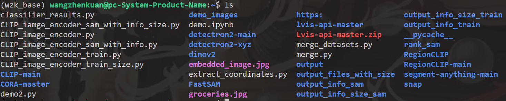

Linux 是一个强大的操作系统，它提供了许多常用的命令行工具，可以帮助我们管理文件、目录、进程、网络和系统配置等。以下按使用场景整理了一些最常用的 Linux 命令。

## 文件与目录操作

### ls：列出目录内容

```bash
ls          # 列出当前目录中的文件和子目录
ls -l       # 长格式显示（权限、大小、修改时间等）
ls -a       # 显示隐藏文件（. 开头的文件）
ls -lh      # 大小以人类可读单位显示（K、M、G）
ls -lt      # 按修改时间排序
```



### cd：切换目录

```bash
cd /home/user/docs    # 进入绝对路径
cd ..                 # 返回上一级
cd ~                  # 回到当前用户的家目录
cd -                  # 回到上一次所在的目录
```

### pwd：显示当前所在目录

```bash
pwd
```

### mkdir：创建目录

```bash
mkdir test          # 创建单个目录
mkdir -p a/b/c      # 递归创建多级目录
mkdir dir1 dir2     # 同时创建多个目录
```

### rm：删除文件或目录

```bash
rm file.txt         # 删除文件（会询问确认）
rm -f file.txt      # 强制删除，不询问
rm -r dir/          # 递归删除目录
rm -rf dir/         # 强制递归删除
```

::: warning
Linux 下删除**不进回收站、无法撤销**。执行 `rm -rf` 前先确认路径正确，路径带变量拼接时尤其要小心。
:::

### cp：复制文件或目录

```bash
cp file.txt backup.txt      # 复制并重命名
cp file.txt /tmp/           # 复制到指定目录
cp -r dir/ /tmp/            # 递归复制整个目录
```

### mv：移动 / 重命名

```bash
mv file.txt /tmp/           # 移动文件到指定目录
mv old.txt new.txt          # 重命名
mv dir/ /tmp/               # 移动目录（不需要 -r）
```

### touch：创建空文件

```bash
touch file.txt
```

## 查看文件内容

### cat / more / less

```bash
cat file.txt            # 一次性输出整个文件内容
cat -n file.txt         # 带行号输出
more file.txt           # 分页查看（空格翻页，q 退出）
less file.txt           # 分页查看，支持上下键和 / 搜索（大文件推荐）
```

### head / tail

```bash
head -n 20 file.txt                # 查看前 20 行
tail -n 20 file.txt                # 查看最后 20 行
tail -f /var/log/nginx/error.log   # 实时追踪日志新增内容（最常用）
```

## 查找与搜索

### find：按条件查找文件

```bash
find /path -name "*.log"           # 按名字查找
find /path -iname "*.Log"          # 名字忽略大小写
find / -size +100M                 # 查找大于 100M 的文件
find /path -mtime -7               # 查找 7 天内修改过的文件
find /path -name "*.log" -delete   # 查找并删除
```

### grep：文本搜索

```bash
grep "error" app.log          # 输出包含 error 的行
grep -n "error" app.log       # 输出并带行号
grep -i "error" app.log       # 忽略大小写
grep -r "TODO" ./src          # 递归搜索目录下所有文件
grep -c "error" app.log       # 统计匹配的行数
```

### which：查找命令所在路径

```bash
which nginx
```

## 压缩与解压

### tar

```bash
tar -zcvf output.tar.gz dir/        # 打包并压缩目录
tar -zxvf output.tar.gz             # 解压到当前目录
tar -zxvf output.tar.gz -C /tmp/    # 解压到指定目录
```

参数记忆：`-z` 用 gzip、`-c` 创建压缩包、`-x` 解压、`-v` 显示过程、`-f` 指定文件名。

### zip / unzip

```bash
zip -r output.zip dir/          # 压缩目录
unzip output.zip                # 解压到当前目录
unzip output.zip -d /tmp/       # 解压到指定目录
```

## 权限与用户

### chmod：修改文件权限

```bash
chmod +x run.sh         # 给文件加可执行权限
chmod 755 run.sh        # rwxr-xr-x（所有者全权限，其他人可读可执行）
chmod -R 755 dir/       # 递归修改整个目录
```

数字含义：`4` 读（r）、`2` 写（w）、`1` 执行（x），三位数字分别对应**所有者 / 所属组 / 其他人**，相加组合，如 `7 = 4+2+1` 读写执行全有。

### chown：修改文件归属

```bash
sudo chown user:group file.txt
sudo chown -R nginx:nginx /var/www
```

## 进程管理

### ps：查看进程

```bash
ps aux                  # 显示所有进程详情
ps aux | grep nginx     # 配合 grep 过滤指定进程（最常用）
ps -ef                  # 另一种全量格式，带父进程 PID
```

### top：实时监控

```bash
top
```

实时显示 CPU、内存、进程状态（`q` 退出，`P` 按 CPU 排序，`M` 按内存排序）。

### kill：结束进程

```bash
kill 1234           # 正常结束进程
kill -9 1234        # 强制结束（进程无响应时使用）
pkill nginx         # 按进程名结束进程
```

## 网络相关

### ping / curl / wget

```bash
ping huangxi.cc                       # 测试网络连通性
curl https://api.example.com          # 发起 HTTP 请求，输出响应内容
curl -I https://example.com           # 只查看响应头
wget https://example.com/file.tar.gz  # 下载文件
```

### 查看端口占用

```bash
netstat -tunlp                  # 查看监听中的端口和对应进程
netstat -tunlp | grep 80        # 检查 80 端口被谁占用
ss -tunlp                       # netstat 的现代替代（速度更快）
```

### 查看本机 IP

```bash
ip addr         # 推荐
ifconfig        # 老写法，最小安装可能没有该命令
```

### 防火墙（CentOS firewalld）

```bash
sudo firewall-cmd --list-ports                      # 查看已放行的端口
sudo firewall-cmd --permanent --add-port=8080/tcp   # 放行 8080 端口
sudo firewall-cmd --reload                          # 重载使配置生效
```

## 磁盘与系统

```bash
df -h           # 查看各磁盘分区的使用情况
du -sh *        # 查看当前目录下各项占用的空间大小
free -h         # 查看内存使用情况
uname -a        # 查看系统内核信息
uptime          # 查看系统运行时长和负载
```

## 其他实用技巧

### 管道与重定向

```bash
history | grep docker           # 管道：把前一个命令的输出交给后一个命令处理
echo "text" > file.txt          # 覆盖写入文件
echo "text" >> file.txt         # 追加写入文件
cat a.txt b.txt > merged.txt    # 合并文件
```

### history：历史命令

```bash
history                 # 查看历史命令
history | grep ssh      # 搜索历史命令
!1000                   # 直接执行第 1000 条历史命令
```

### vim：编辑文件速记

```bash
vim file.txt
```

- `i`：进入插入模式开始编辑
- `Esc`：回到普通模式
- `:wq`：保存并退出；`:q!`：不保存强制退出
- `/word`：搜索 word（`n` 跳到下一个）

### man：查看命令手册

```bash
man ls          # 查看 ls 的完整手册（q 退出）
ls --help       # 快速查看帮助
```

### 软件包管理

```bash
sudo yum install nginx      # CentOS 安装软件
sudo yum remove nginx       # 卸载软件
sudo apt install nginx      # Ubuntu / Debian 用 apt
```

### 常用快捷键

- `Tab`：自动补全（最常用，路径和命令名都可以补全）
- `Ctrl+C`：终止当前命令
- `Ctrl+L`：清屏（等同 `clear`）
- `Ctrl+R`：搜索历史命令
- `Ctrl+A` / `Ctrl+E`：光标跳到行首 / 行尾
